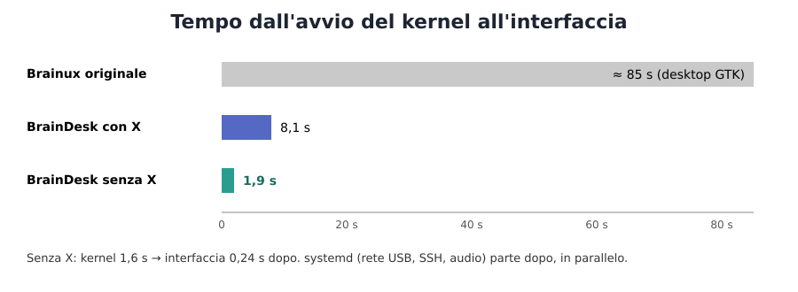
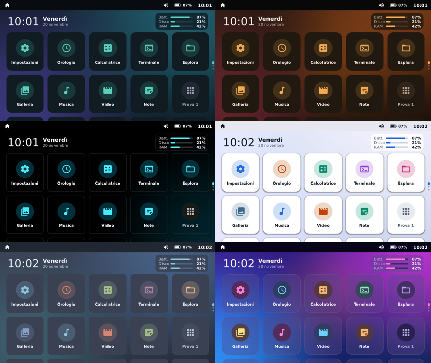
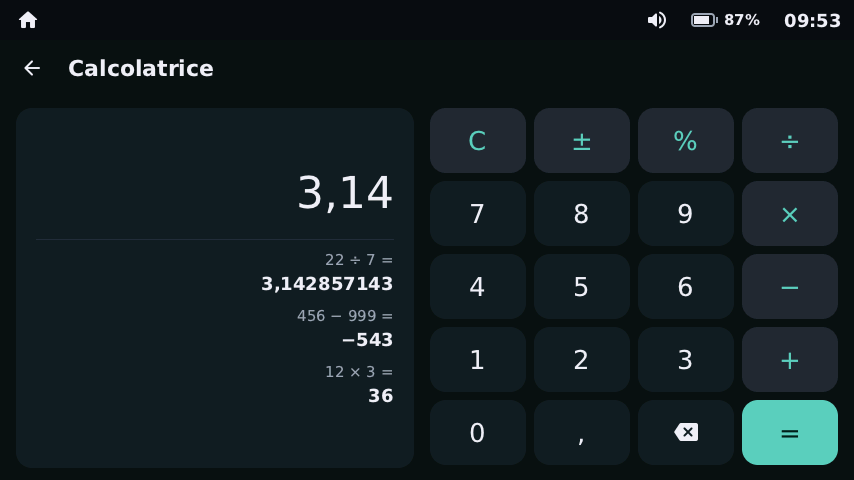
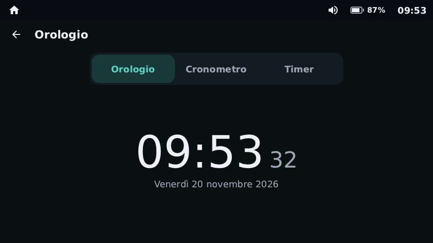
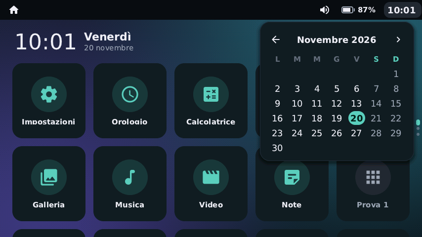
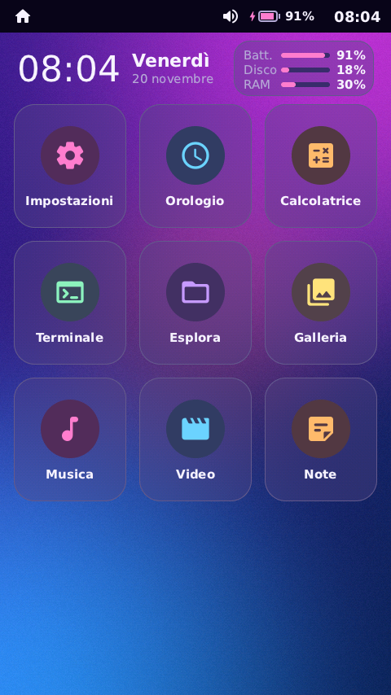
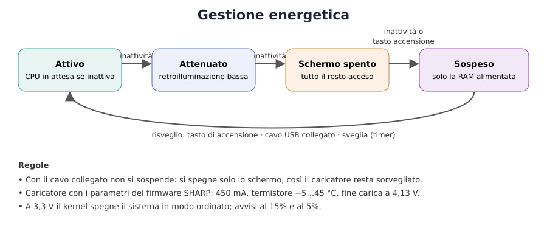

# BrainDesk

🇬🇧 English · 🇮🇹 [Italiano](README.it.md)

**A fast, lightweight touch operating system for the SHARP Brain PW-SH5 electronic dictionary.**

BrainDesk turns a 2015 Japanese dictionary (480 MHz ARM9 CPU, 112 MB of RAM, no GPU)
into a small pocket computer with a touch interface, themes, animations, music,
video, photos, notes and a terminal. It boots from the microSD card without touching
the original Windows CE, and shows its interface **1.9 seconds** after the kernel
starts.

<p align="center">
  
</p>

> All `device-*` images are real captures of the Brain's video memory; the others
> come from the shell's automated tests (same code, same RGB565 format at 854×480).
> The user interface itself is in Italian.

---

## Contents

- [Why](#why)
- [What works today](#what-works-today)
- [Numbers measured on the device](#numbers-measured-on-the-device)
- [Architecture](#architecture)
- [The interface: BrainShell](#the-interface-brainshell)
- [Power management](#power-management)
- [Keys](#keys)
- [The kernel: what we added](#the-kernel-what-we-added)
- [Hardware acceleration](#hardware-acceleration)
- [Installation](#installation)
- [Building](#building)
- [Repository layout](#repository-layout)
- [How we got here](#how-we-got-here)
- [Roadmap](#roadmap)
- [Licences and credits](#licences-and-credits)

---

## Why

The PW-SH5 has a nice 5" panel, a QWERTY keyboard, touch, a speaker and a lithium
battery, but its software is Japanese-only and closed. The
[Brainux](https://github.com/brain-hackers) project can already boot Debian from the
microSD card; BrainDesk starts from there and focuses on three things only:

1. **polished graphics and usability**, with a finger and with the keyboard;
2. **the fastest possible boot**;
3. **minimal use** of memory, CPU and energy.

## What works today

| Area | Status |
|---|---|
| Touch interface (BrainShell) without X11, themes, animations | ✅ on the device |
| Apps: Settings, Clock (stopwatch, timer), Calculator, File explorer, Gallery, Music, Video, Notes, Terminal | ✅ on the device |
| Native media player with PXP-accelerated video | ✅ 20 fps, 0 dropped frames |
| Display: row-based updates, rotation, video overlay | ✅ |
| Audio (speaker, microphone, headphones with detection) | ✅ |
| Battery charging under Linux (it never charged before) | ✅ |
| Clock shared with Windows CE, no drift | ✅ |
| Power button, suspend with wake-up (button, USB, alarm), auto-suspend, power saving mode, battery time estimate | ✅ |
| Brightness, dimming and screen-off when idle | ✅ |
| Rescue boot with the stock kernel (three resets) | ✅ |
| Compressed swap in RAM (zram) | ✅ |
| Dictionary keys (国語, 英和, Brain English, マイ辞書, 履歴) with shell functions: recent-apps switcher, quick settings, music play/pause, notes, screenshot, Onsei + key for brightness/volume; configurable in Settings → Keys | ✅ verified on the device (simulated key presses) |
| Native terminal (no X): PTY + built-in VT100/xterm emulator (256 colours/truecolor, scroll regions, alternate screen, UTF-8), 106×24 cells, 1000-line scrollback with touch scrolling, touch key bar; `st` under X kept as a fallback | ✅ opens instantly on the device |

## Numbers measured on the device

<p align="center"></p>

| Measurement | Before | BrainDesk |
|---|---|---|
| Interface ready after kernel start | ≈ 85 s | **1.9 s** |
| Shell's first frame after it starts | – | **0.24 s** |
| RAM used with the interface open (of 112 MB) | 39–45 MB (with X) | **33 MB** |
| Shell memory | – | ≈ 4.5 MB |
| Video: start to first frame | ≈ 19 s (ffmpeg) | **0.6 s** |
| 424×240 video at 20 fps | 15 fps (ffmpeg + X window) | **20 fps, 0 dropped**, A/V sync 0.3 ms |
| Convert + scale one full-screen frame | 120 ms (CPU) | **6 ms** (PXP) |
| Panel update: full screen / one line of text | 17 ms / 17 ms | 17 ms / **0.5 ms** |
| App open animation | – | 6 frames in 150 ms (≈ 33 fps) |
| CPU when idle | – | no wake-ups besides the minute tick of the clock |

## Architecture

<p align="center"></p>

**Boot sequence**

1. SHARP's loader on the eMMC finds the `ed*exe.bin` files on the microSD and starts U-Boot.
2. `uEnv.txt` picks the kernel: normal, *trial* (once only, to develop without risk)
   or *rescue* (the stock Brainux kernel) if the last two boots did not complete.
3. The kernel runs `brain-preinit` instead of systemd: it mounts the bare minimum,
   starts **BrainShell** directly on the display, then hands over to systemd, which
   brings up the USB network, SSH and audio **in parallel**, without making the user wait.
4. X11 never starts at boot: the shell starts it only when you open an app that needs
   it (the terminal) and stops it when you close that app.

## The interface: BrainShell

A shell written from scratch in C for this hardware: no GTK, no fontconfig, no
floating point (the CPU has no FPU). It draws in RAM and sends the panel only the
rectangles that changed, grouped into row bands, because the panel receives pixels
row by row. When idle it uses no CPU.

<p align="center">
  
  <br><em>Six themes: Teal, Brace, Nero, Chiaro, Nord, Aurora (glass)</em>
</p>

| | |
|---|---|
|  |  |
| Calculator (touch and hardware keys) | Clock, stopwatch, timer |
|  |  |
| File explorer: files, text, images, audio/video | Gallery with cached thumbnails |
|  |  |
| Music (keeps playing in the background) | Notes with an editor and autosave |
|  |  |
| Quick settings from the status bar | Settings: display, appearance, power |
|  |  |
| Editable home (press and hold, drag) | Calendar from the clock |

**Features**

- Home screen with a large clock, date, battery, disk and RAM gauges and the track now playing.
- Search apps by typing on the keyboard.
- Time-based (not frame-based), interruptible animations with a per-frame pixel
  budget; configurable as *full*, *reduced* or *none*.
- Portrait and landscape: the interface lays itself out again.
- Accented letters without dead keys: **Onsei + vowel** (à è é ì ò ù ç, € °).
- External X11 apps on demand; the Home key always brings you back to the home screen.

<p align="center">
  
  &nbsp;
  
  <br><em>On the Brain: portrait interface · video decoded by brainplay and scaled by the PXP</em>
</p>

## Power management

<p align="center"></p>

- **Charging**: the i.MX28 has a linear charger but no controller, and unless the
  operating system runs it the battery never charges. The `brain_battery` driver
  reproduces the state machine of SHARP's firmware, recovered by disassembling
  Windows CE (`ref/wince/charger-notes.md`): 80 mA pre-charge below 3.0 V, 450 mA
  from a USB port with the input limited to 480 mA, charge complete below 50 mA at
  4.13 V, recharge below 4.0 V, battery thermistor window −5…45 °C, chip thermal
  protection, safety timeout.
- **Battery level** from the open-circuit voltage (Li-ion curve, compensating the
  rise while charging); clean shutdown at 3.3 V.
- **Power button**: a new driver (`Brain Power Button`, the PSWITCH line of the power
  block) that also works as a wake-up source.
- **Suspend**: `brain-ctl suspend [seconds]`; wakes up on the button, when the USB
  cable is plugged in, or on the internal clock's alarm (also used by the timer).
- **Display**: backlight dimming and screen-off when idle, brightness from the status bar.
- **Memory**: 64 MB zram swap in compressed RAM, no swap writes to the microSD.

## Keys

| Brain key | Code | Function |
|---|---|---|
| ホーム (Home) | `KEY_HOMEPAGE` | back to the home screen from anywhere, also from the terminal |
| 戻る (Back) | `KEY_ESC` | one level back, closes dialogs |
| Arrows, Enter, Space, Backspace | standard | full navigation without touch |
| 音声 (Onsei) | `KEY_LEFTALT` | Onsei + vowel = accented letter |
| ページ↑ | `KEY_LEFTCTRL` | Ctrl |
| 記号 (Symbols) | symbol layer | digits and punctuation |
| Power | `KEY_POWER` | suspend / wake; held: power menu |
| 国語, 英和・和英, Brain English, マイ辞書, 履歴 | PgUp, PgDn, Tab, Ins, Del | 🔜 dedicated functions |

## The kernel: what we added

Base: Brainux's `linux-brain`, Linux 6.1.70. Everything is in
[`kernel/patches/0001-brain-pw-sh5-hardware.patch`](kernel/patches/0001-brain-pw-sh5-hardware.patch);
board changes live only in `imx28-pwsh5.dts`, so other Brain models are unaffected.

| Driver | What it does |
|---|---|
| `drivers/misc/brain_pxp.c` | PXP v2 as `/dev/pxp`: YUV→RGB, scaling, rotation, dma-buf, direct overlay onto the display |
| `drivers/gpu/drm/tiny/brain.c` | row-based updates, rotation from the device tree, frame-buffer access for the overlay, fixes |
| `sound/soc/codecs/bu26154.c`, `sound/soc/mxs/mxs-brain.c` | ROHM BU26154 codec (identified from the firmware), speaker, microphone, headphones |
| `drivers/power/supply/brain_battery.c` | battery, USB, charger, thermistor, power button, wake-up sources |
| `drivers/rtc/rtc-stmp3xxx.c` | time shared with Windows CE, 32 kHz crystal, alarm as a wake-up source |
| device tree | USB in device mode (network to the PC), dedicated Home key, audio/PXP/battery nodes |
| config | 8 MB CMA, zram |

An independent review of the code is in [`ref/review-kernel.md`](ref/review-kernel.md).

## Hardware acceleration

The i.MX28 has no GPU and no 2D blitter: its only graphics engine is the **PXP**
(Pixel Pipeline). BrainDesk uses it where it really pays off:

- **video**: YUV→RGB conversion and scaling straight into the panel's frame buffer,
  with no CPU copies (6 ms instead of 120 ms per frame);
- **screen rotation**: done by the panel controller (zero cost);
- **interface**: stays in software, because for small areas the PXP's start-up cost
  exceeds the work itself; the real acceleration is sending the panel only the rows
  that changed.

## Installation

> ⚠️ You need a PW-SH5 with [Brainux](https://github.com/brain-hackers/buildbrain)
> already on the microSD card and the Brain connected to the PC over USB. The internal
> memory (Windows CE) is never modified: remove the microSD card and the original
> dictionary comes back.

```sh
# 1. kernel and device tree (from the release, or built, see below)
scp zImage imx28-pwsh5.dtb brain:/tmp/
ssh brain 'brain-trial /tmp/zImage /tmp/imx28-pwsh5.dtb && sudo reboot'   # try it once
# 2. system and interface
scp -r os brain:~/braindesk && ssh brain 'cd ~/braindesk && sh install.sh && sudo reboot'
```

`brain-trial` boots a kernel only once: if it hangs, one reset goes back to the
previous one. Three quick resets boot the stock Brainux kernel.

## Building

You need Docker. Everything builds with the same Debian armel toolchain the Brain runs.

```sh
# kernel (output in out/)
docker build -t brain-kbuild kernel/docker
docker run --rm -v brain-kernel:/kernel -v "$PWD/kernel":/src brain-kbuild /src/docker/build-kernel.sh

# shell
docker build -t brain-userland kernel/docker/userland
docker run --rm -v "$PWD/shell":/src brain-userland make -C /src armel

# media player (downloads and builds a minimal FFmpeg)
cd player && ./build.sh image && ./build.sh ffmpeg-armel && ./build.sh armel
```

The shell's tests run on a PC without the Brain (Xvfb and an in-memory backend):
see [`shell/README.md`](shell/README.md) (in Italian).

## Repository layout

```
kernel/    kernel patch, config, Docker build environment
shell/     BrainShell: graphics toolkit, compositor, apps, tests
player/    brainplay: media player with a minimal FFmpeg and the PXP
os/        system scripts: fast boot, brain-ctl, suspend, installer
driver/    PXP and panel test tools
tools/     apt proxy over USB
ref/       reverse-engineering notes (SHARP charger), kernel review
docs/      images for this document
```

## How we got here

1. **USB and Linux**: the dictionary's USB mode, Brainux on the microSD, NCM
   networking over USB and SSH, internet through a proxy on the PC.
2. **Missing drivers**: a PXP driver from scratch, the audio codec identified by
   reading the Windows CE firmware, the clock shared with WinCE, the battery,
   headphone detection (found by disassembling the WinCE audio driver), direct boot
   into Linux.
3. **Graphics**: row-based panel updates (from 17 ms to 0.5 ms for a line of text),
   windowed and full-screen video with the PXP.
4. **A boot hang** after a full discharge turned out to be our own bug: panel commands
   were sent while the controller was in DMA mode. It led to the *once-only* trial
   boot and the rescue kernel, and to discovering that under Linux the battery never
   charged at all.
5. **Charger**: parameters copied from the disassembled SHARP firmware.
6. **Interface**: BrainShell with six themes, animations and eight apps, then the
   brainplay player (from 19 s to 0.6 s), then the shell without X (from 8 s to 1.9 s).
7. **Power**: the power button (previously ignored by Linux), suspend with three
   wake-up sources, a clock without drift.

Several subsystems were developed in parallel by separate agents and integrated on
the device: shell, apps, player, firmware analysis, driver review.

## Roadmap

**Power and battery life**
- Full suspend policy in the shell: power button, auto-suspend when idle, no suspend
  on the cable (the charger stays supervised), a *power saving* mode. *(in progress)*
- Remaining battery time estimate.
- Real power measurements in suspend and with the screen on.

**Keys and usability**
- Dedicated functions for the dictionary keys (国語, 英和, Brain English, マイ辞書, 履歴),
  for example app shortcuts or app switching.
- On-panel check of portrait rotation and idle screen-off.

**Speed and footprint**
- A native terminal inside the shell (today it goes through X, about 11 s to open).
- Video without X: the player's overlay beneath the shell's control bar.
- Fewer systemd services and a minimal system image (today 2 GB, 732 packages).
- A kernel built only for the PW-SH5.

**Features**
- Offline dictionary (Japanese–Italian/English) and a Japanese font.
- A boot logo instead of U-Boot's text.
- Rotation without a reboot.

## Licences and credits

- Kernel patch and drivers: **GPL-2.0** (like Linux). The rest of the code in this
  repository is released under the same licence (see `LICENSE`).
- Bundled third-party components: `stb_image`/`stb_truetype` (public domain / MIT),
  TJpgDec (ChaN's BSD-style licence), Material Icons (Apache 2.0), DejaVu fonts
  (Bitstream Vera free licence). FFmpeg, libopus, Tremor and libogg are downloaded at
  build time (LGPL/BSD).
- Built on the work of [brain-hackers / Brainux](https://github.com/brain-hackers).
- SHARP's firmware and its disassembly are not included: `ref/` only contains the
  notes and scripts used to analyse it.
- SHARP and Brain are trademarks of their respective owners; this project is not affiliated.
