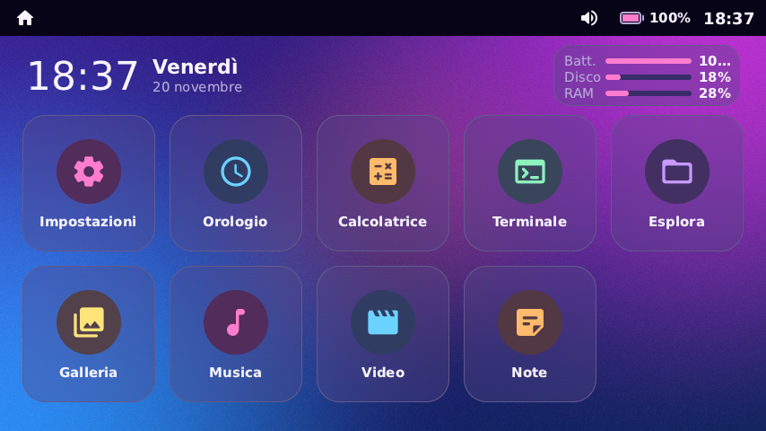
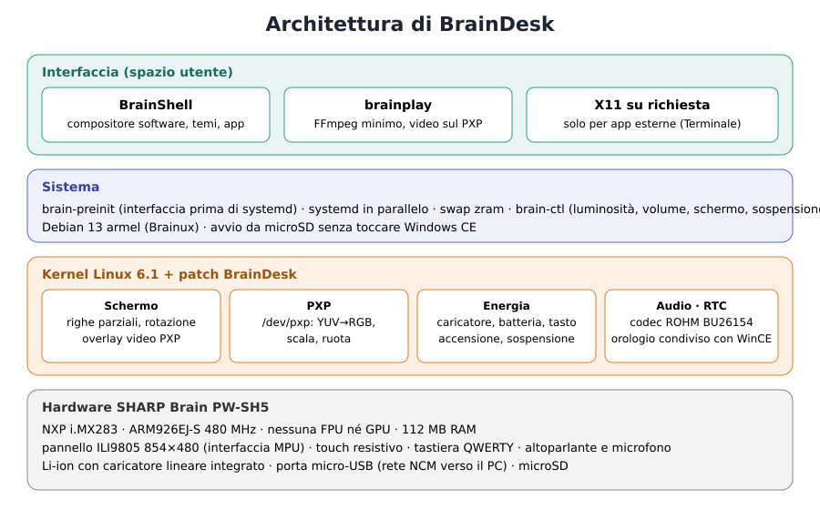
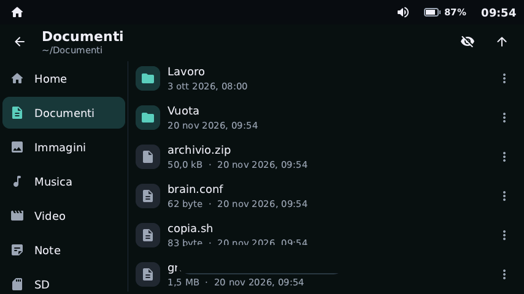
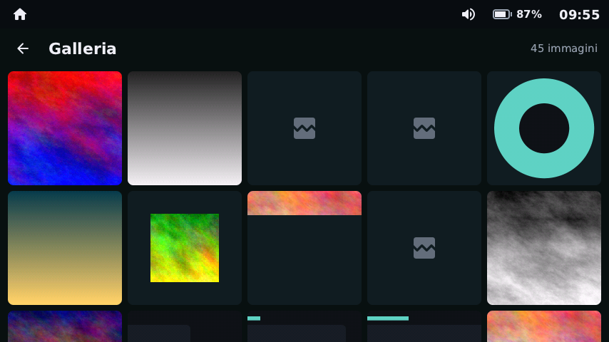
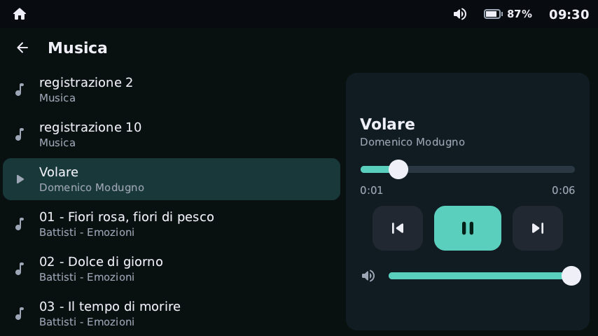
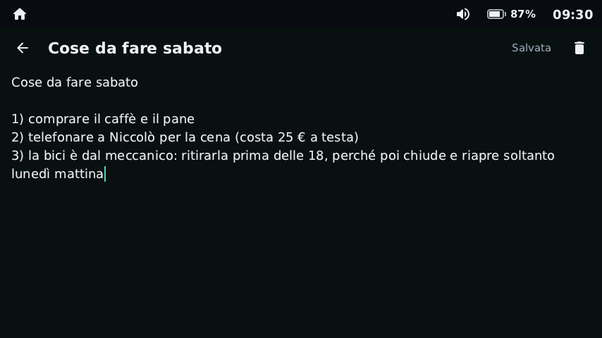
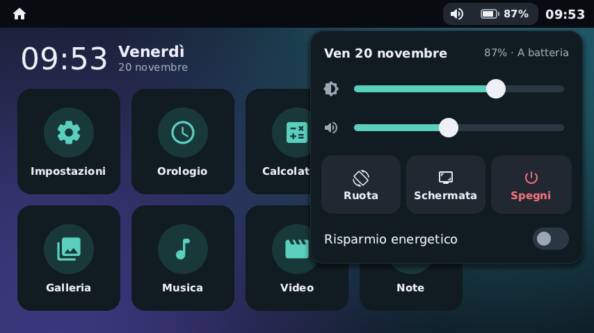
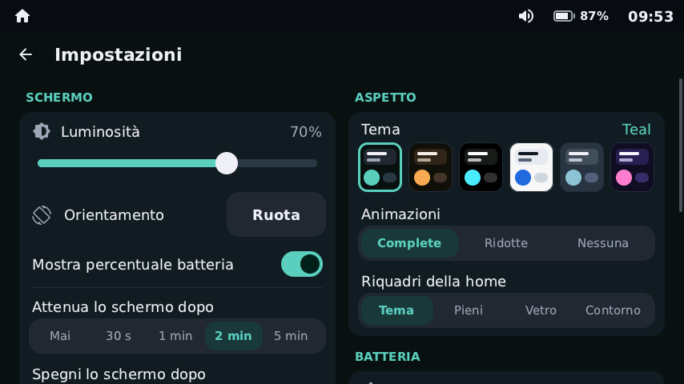
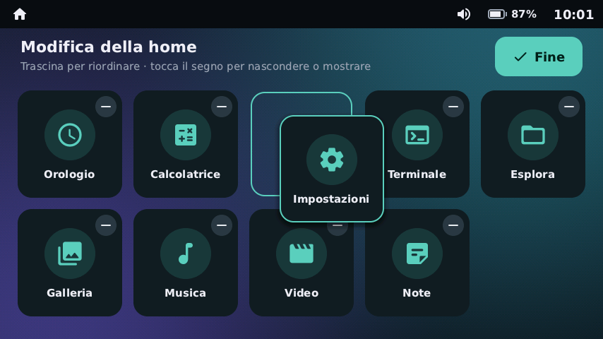
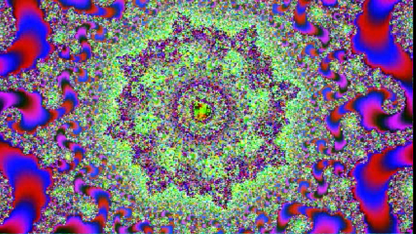

# BrainDesk

**Un sistema operativo touch, veloce e leggero per il dizionario elettronico SHARP Brain PW-SH5.**

BrainDesk trasforma un dizionario giapponese del 2015 (processore ARM9 a 480 MHz,
112 MB di RAM, nessuna GPU) in un piccolo computer tascabile con interfaccia touch,
temi, animazioni, musica, video, foto, note e terminale. Parte dalla microSD
senza toccare il Windows CE originale e mostra l'interfaccia **1,9 secondi** dopo
l'avvio del kernel.

<p align="center">
  
</p>

> Tutte le immagini `device-*` sono catture reali della memoria video del Brain;
> le altre vengono dai test automatici della shell (stesso codice, stesso formato
> RGB565 a 854×480).

---

## Indice

- [Perché](#perché)
- [Cosa c'è oggi](#cosa-cè-oggi)
- [Numeri misurati sul dispositivo](#numeri-misurati-sul-dispositivo)
- [Architettura](#architettura)
- [L'interfaccia: BrainShell](#linterfaccia-brainshell)
- [Gestione energetica](#gestione-energetica)
- [Tasti](#tasti)
- [Il kernel: cosa abbiamo aggiunto](#il-kernel-cosa-abbiamo-aggiunto)
- [Accelerazione hardware](#accelerazione-hardware)
- [Installazione](#installazione)
- [Compilare](#compilare)
- [Struttura del repository](#struttura-del-repository)
- [Come ci siamo arrivati](#come-ci-siamo-arrivati)
- [Cosa faremo](#cosa-faremo)
- [Licenze e riconoscimenti](#licenze-e-riconoscimenti)

---

## Perché

Il PW-SH5 ha un bel pannello da 5", tastiera QWERTY, touch, altoparlante e una
batteria al litio, ma il suo software è solo giapponese e chiuso. Il progetto
[Brainux](https://github.com/brain-hackers) permette già di avviare Debian dalla
microSD; BrainDesk parte da lì e punta a tre cose sole:

1. **grafica curata e usabilità** con il dito e con la tastiera;
2. **avvio il più rapido possibile**;
3. **consumo minimo** di memoria, CPU ed energia.

## Cosa c'è oggi

| Area | Stato |
|---|---|
| Interfaccia touch (BrainShell) senza X11, temi, animazioni | ✅ sul dispositivo |
| App: Impostazioni, Orologio (cronometro, timer), Calcolatrice, Esplora file, Galleria, Musica, Video, Note, Terminale | ✅ sul dispositivo |
| Lettore multimediale nativo con video accelerato dal PXP | ✅ 20 fps, 0 fotogrammi persi |
| Schermo: aggiornamenti per righe, rotazione, overlay video | ✅ |
| Audio (altoparlante, microfono, cuffie con rilevamento) | ✅ |
| Ricarica della batteria sotto Linux (prima non caricava mai) | ✅ |
| Orologio condiviso con Windows CE, senza deriva | ✅ |
| Tasto di accensione, sospensione con risveglio (tasto, USB, sveglia) | ✅ kernel · 🔧 politica nella shell |
| Luminosità, attenuazione e spegnimento dello schermo a riposo | ✅ |
| Avvio di soccorso col kernel originale (tre reset) | ✅ |
| Swap compresso in RAM (zram) | ✅ |
| Tasti dizionario (国語, 英和, Brain English, cronologia…) con funzioni proprie | 🔜 |

## Numeri misurati sul dispositivo

<p align="center"></p>

| Misura | Prima | BrainDesk |
|---|---|---|
| Interfaccia pronta dopo l'avvio del kernel | ≈ 85 s | **1,9 s** |
| Primo fotogramma della shell dopo il suo avvio | – | **0,24 s** |
| RAM usata con l'interfaccia aperta (su 112 MB) | 39–45 MB (con X) | **33 MB** |
| Memoria della shell | – | ≈ 4,5 MB |
| Video: avvio fino al primo fotogramma | ≈ 19 s (ffmpeg) | **0,6 s** |
| Video 424×240 a 20 fps | 15 fps (ffmpeg + finestra X) | **20 fps, 0 persi**, sincronia audio 0,3 ms |
| Conversione+scala di un fotogramma a tutto schermo | 120 ms (CPU) | **6 ms** (PXP) |
| Aggiornamento del pannello: tutto / riga di testo | 17 ms / 17 ms | 17 ms / **0,5 ms** |
| Animazione di apertura di un'app | – | 6 fotogrammi in 150 ms (≈ 33 fps) |
| CPU a riposo | – | 0 risvegli oltre al minuto dell'orologio |

## Architettura

<p align="center"></p>

**Sequenza di avvio**

1. Il loader SHARP sulla eMMC trova i file `ed*exe.bin` nella microSD e avvia U-Boot.
2. `uEnv.txt` sceglie il kernel: normale, *di prova* (una volta sola, per sviluppare
   senza rischi) o *di soccorso* (il kernel originale di Brainux) se gli ultimi due
   avvii non sono arrivati in fondo.
3. Il kernel esegue `brain-preinit` invece di systemd: monta il minimo, avvia
   **BrainShell** direttamente sullo schermo e poi passa il testimone a systemd,
   che avvia rete USB, SSH e audio **in parallelo**, senza far aspettare l'utente.
4. X11 non parte mai all'avvio: lo avvia la shell solo quando apri un'app che ne ha
   bisogno (il Terminale) e lo chiude quando la chiudi.

## L'interfaccia: BrainShell

Una shell scritta da zero in C per questo hardware: niente GTK, niente fontconfig,
niente virgola mobile (la CPU non ha FPU). Disegna in RAM e manda al pannello solo
i rettangoli cambiati, raggruppati per righe, perché il pannello riceve i pixel per
righe. A riposo non consuma CPU.

<p align="center">
  
  <br><em>Sei temi: Teal, Brace, Nero, Chiaro, Nord, Aurora (vetro)</em>
</p>

| | |
|---|---|
|  |  |
| Calcolatrice (tastiera touch e fisica) | Orologio, cronometro, timer |
|  |  |
| Esplora: file, testo, immagini, audio/video | Galleria con miniature in cache |
|  |  |
| Musica (continua in sottofondo) | Note con editor e salvataggio automatico |
|  |  |
| Impostazioni rapide dalla barra | Impostazioni: schermo, aspetto, energia |
|  |  |
| Home modificabile (tieni premuto, trascina) | Calendario dall'orologio |

**Caratteristiche**

- Home con orologio grande, data, batteria, disco, RAM e brano in riproduzione.
- Ricerca delle app scrivendo con la tastiera.
- Animazioni a tempo (non a fotogrammi), interrompibili, con budget di pixel per
  fotogramma; regolabili su *complete*, *ridotte* o *nessuna*.
- Verticale e orizzontale: l'interfaccia si ridispone da sola.
- Lettere accentate senza tasti morti: **Onsei + vocale** (à è é ì ò ù ç, € °).
- App esterne X11 su richiesta; il tasto Home riporta sempre alla home.

<p align="center">
  
  &nbsp;
  
  <br><em>Sul Brain: interfaccia in verticale · video decodificato da brainplay e scalato dal PXP</em>
</p>

## Gestione energetica

<p align="center"></p>

- **Ricarica**: l'i.MX28 ha un caricatore lineare ma nessun controllore, e senza
  sistema operativo che lo gestisca la batteria non si carica. Il driver
  `brain_battery` ripete la macchina a stati del firmware SHARP, ricavata
  disassemblando Windows CE (`ref/wince/charger-notes.md`): precarica a 80 mA sotto
  3,0 V, 450 mA da porta USB con ingresso limitato a 480 mA, fine carica sotto
  50 mA a 4,13 V, ripresa sotto 4,0 V, termistore della batteria tra −5 e 45 °C,
  protezione termica del chip, timeout.
- **Livello batteria** dalla tensione a vuoto (curva Li-ion, compensando la
  caduta durante la carica); spegnimento ordinato a 3,3 V.
- **Tasto di accensione**: driver nuovo (`Brain Power Button`, linea PSWITCH del
  blocco di alimentazione) che funziona anche da risveglio.
- **Sospensione**: `brain-ctl suspend [secondi]`; si risveglia col tasto, collegando
  il cavo USB o con la sveglia dell'orologio interno (anche per il timer).
- **Schermo**: attenuazione e spegnimento della retroilluminazione a riposo,
  luminosità dalla barra.
- **Memoria**: swap zram da 64 MB in RAM compressa, nessuna scrittura di swap sulla
  microSD.

## Tasti

| Tasto del Brain | Codice | Funzione |
|---|---|---|
| ホーム (Home) | `KEY_HOMEPAGE` | torna alla home da ovunque, anche dal Terminale |
| 戻る (Indietro) | `KEY_ESC` | indietro di un livello, chiude dialoghi |
| Frecce, Invio, Spazio, Backspace | standard | navigazione completa senza touch |
| 音声 (Onsei) | `KEY_LEFTALT` | Onsei + vocale = lettera accentata |
| ページ↑ | `KEY_LEFTCTRL` | Ctrl |
| 記号 (Simboli) | livello simboli | cifre e punteggiatura |
| Accensione | `KEY_POWER` | sospendi / risveglia; tenuto premuto: menu di spegnimento |
| 国語, 英和・和英, Brain English, マイ辞書, 履歴 | PagSu, PagGiù, Tab, Ins, Canc | 🔜 funzioni dedicate |

## Il kernel: cosa abbiamo aggiunto

Base: `linux-brain` di Brainux, Linux 6.1.70. Tutto in
[`kernel/patches/0001-brain-pw-sh5-hardware.patch`](kernel/patches/0001-brain-pw-sh5-hardware.patch);
le modifiche alla scheda sono solo in `imx28-pwsh5.dts`, gli altri modelli Brain
non cambiano.

| Driver | Cosa fa |
|---|---|
| `drivers/misc/brain_pxp.c` | PXP v2 come `/dev/pxp`: YUV→RGB, scala, rotazione, dma-buf, overlay diretto sullo schermo |
| `drivers/gpu/drm/tiny/brain.c` | aggiornamenti per righe, rotazione dal device tree, accesso al frame buffer per l'overlay, correzioni |
| `sound/soc/codecs/bu26154.c`, `sound/soc/mxs/mxs-brain.c` | codec ROHM BU26154 (identificato dal firmware), altoparlante, microfono, cuffie |
| `drivers/power/supply/brain_battery.c` | batteria, USB, caricatore, termistore, tasto di accensione, risvegli |
| `drivers/rtc/rtc-stmp3xxx.c` | ora condivisa con Windows CE, quarzo da 32 kHz, sveglia come risveglio |
| device tree | USB in modalità dispositivo (rete col PC), tasto Home dedicato, nodi audio/PXP/batteria |
| config | CMA 8 MB, zram |

Una revisione indipendente del codice è in [`ref/review-kernel.md`](ref/review-kernel.md).

## Accelerazione hardware

L'i.MX28 non ha GPU né blitter 2D: l'unico motore grafico è il **PXP** (Pixel
Pipeline). BrainDesk lo usa dove conviene davvero:

- **video**: conversione YUV→RGB e scala direttamente nel frame buffer del
  pannello, senza copie della CPU (6 ms invece di 120 ms a fotogramma);
- **rotazione dello schermo**: fatta dal controller del pannello (costo zero);
- **interfaccia**: resta in software, perché sulle aree piccole il costo d'avvio
  del PXP supera il lavoro; la vera accelerazione è mandare al pannello solo le
  righe cambiate.

## Installazione

> ⚠️ Serve un PW-SH5 con [Brainux](https://github.com/brain-hackers/buildbrain) già
> sulla microSD e il Brain collegato al PC via USB. La memoria interna (Windows CE)
> non viene mai modificata: togliendo la microSD torna il dizionario originale.

```sh
# 1. kernel e device tree (dalla release o compilati, vedi sotto)
scp zImage imx28-pwsh5.dtb brain:/tmp/
ssh brain 'brain-trial /tmp/zImage /tmp/imx28-pwsh5.dtb && sudo reboot'   # prova una volta
# 2. sistema e interfaccia
scp -r os brain:~/braindesk && ssh brain 'cd ~/braindesk && sh install.sh && sudo reboot'
```

`brain-trial` prova un kernel una sola volta: se si blocca, un reset riporta a quello
precedente. Tre reset ravvicinati avviano il kernel originale di Brainux.

## Compilare

Serve Docker. Tutto si compila con gli stessi compilatori di Debian armel del Brain.

```sh
# kernel (risultato in out/)
docker build -t brain-kbuild kernel/docker
docker run --rm -v brain-kernel:/kernel -v "$PWD/kernel":/src brain-kbuild /src/docker/build-kernel.sh

# shell
docker build -t brain-userland kernel/docker/userland
docker run --rm -v "$PWD/shell":/src brain-userland make -C /src armel

# lettore multimediale (scarica e compila FFmpeg minimo)
cd player && ./build.sh image && ./build.sh ffmpeg-armel && ./build.sh armel
```

I test della shell girano su PC senza il Brain (Xvfb e un backend in memoria):
vedi [`shell/README.md`](shell/README.md).

## Struttura del repository

```
kernel/    patch del kernel, config, ambiente di compilazione Docker
shell/     BrainShell: toolkit grafico, compositore, app, test
player/    brainplay: lettore multimediale con FFmpeg minimo e PXP
os/        script di sistema: avvio rapido, brain-ctl, sospensione, installazione
driver/    strumenti di prova del PXP e del pannello
tools/     proxy per apt via USB
ref/       note di reverse engineering (caricatore SHARP), revisione del kernel
docs/      immagini di questo documento
```

## Come ci siamo arrivati

1. **USB e Linux**: modalità USB del dizionario, Brainux sulla microSD, rete NCM
   via USB e SSH, internet tramite un proxy sul PC.
2. **Driver mancanti**: PXP da zero, codec audio identificato leggendo il firmware
   Windows CE, orologio condiviso con WinCE, batteria, rilevamento cuffie (ricavato
   disassemblando il driver audio WinCE), avvio diretto di Linux.
3. **Grafica**: aggiornamenti per righe del pannello (da 17 ms a 0,5 ms per una riga
   di testo), video in finestra e a tutto schermo col PXP.
4. **Un blocco all'avvio** dopo una scarica completa si è rivelato un bug nostro: i
   comandi al pannello partivano col controller in modalità DMA. Da lì sono nati
   l'avvio di prova *una volta sola* e il kernel di soccorso, e la scoperta che sotto
   Linux la batteria non si caricava mai.
5. **Caricatore**: parametri copiati dal firmware SHARP disassemblato.
6. **Interfaccia**: BrainShell con sei temi, animazioni e otto app, poi il lettore
   brainplay (da 19 s a 0,6 s), poi la shell senza X (da 8 s a 1,9 s).
7. **Energia**: tasto di accensione (prima ignorato da Linux), sospensione con tre
   sorgenti di risveglio, orologio senza deriva.

Diversi sotto-sistemi sono stati sviluppati in parallelo da agenti separati e
integrati sul dispositivo: shell, app, lettore, analisi del firmware, revisione dei
driver.

## Cosa faremo

**Energia e autonomia**
- Politica completa di sospensione nella shell: tasto di accensione, sospensione
  automatica dopo l'inattività, niente sospensione col cavo (il caricatore resta
  sorvegliato), modalità *risparmio energetico*. *(in corso)*
- Stima del tempo residuo della batteria.
- Misura reale dei consumi in sospensione e a schermo acceso.

**Tasti e usabilità**
- Funzioni proprie per i tasti del dizionario (国語, 英和, Brain English, マイ辞書,
  履歴), per esempio scorciatoie ad app o al cambio di app.
- Verifica sul pannello di rotazione verticale e spegnimento a riposo.

**Velocità e leggerezza**
- Terminale nativo nella shell (oggi passa da X, ~11 s per aprirlo).
- Video senza X: overlay del lettore sotto la barra della shell.
- Meno servizi systemd e un'immagine di sistema essenziale (oggi 2 GB, 732 pacchetti).
- Kernel solo per il PW-SH5.

**Funzioni**
- Dizionario offline (giapponese–italiano/inglese) e font giapponese.
- Logo di avvio al posto delle scritte di U-Boot.
- Rotazione senza riavvio.

## Licenze e riconoscimenti

- Patch del kernel e driver: **GPL-2.0** (come Linux). Il resto del codice di
  questo repository è distribuito con la stessa licenza (vedi `LICENSE`).
- Componenti di terzi inclusi: `stb_image`/`stb_truetype` (pubblico dominio / MIT),
  TJpgDec (licenza BSD-like di ChaN), Material Icons (Apache 2.0), font DejaVu
  (licenza libera Bitstream Vera). FFmpeg, libopus, Tremor e libogg vengono scaricati
  in fase di compilazione (LGPL/BSD).
- Basato sul lavoro di [brain-hackers / Brainux](https://github.com/brain-hackers).
- Il firmware SHARP e i suoi disassemblati non sono inclusi: in `ref/` ci sono solo
  le note e gli script usati per analizzarlo.
- SHARP e Brain sono marchi dei rispettivi proprietari; progetto non affiliato.
